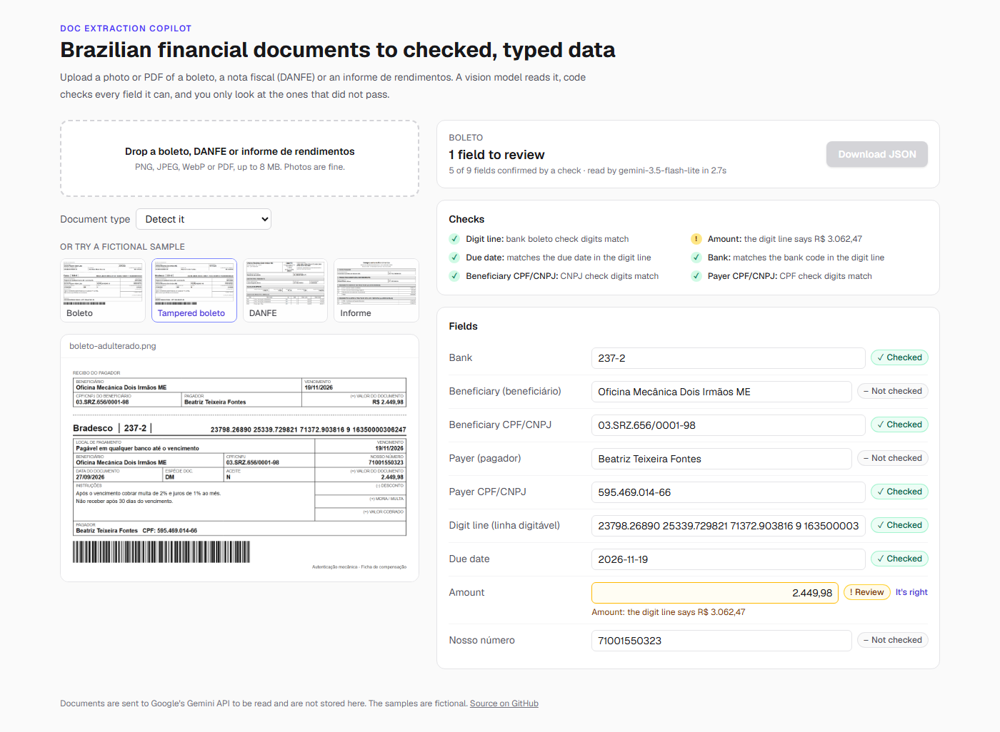
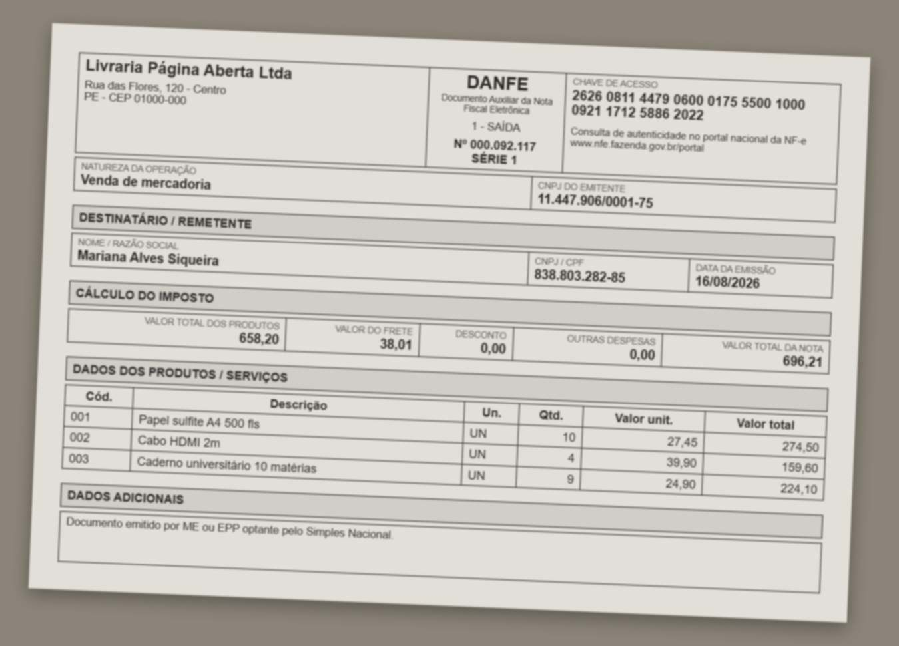

# Doc Extraction Copilot

[](https://github.com/Eric-Souza/doc-extraction-copilot/actions/workflows/ci.yml)

Upload a photo or PDF of a Brazilian financial document (a **boleto**, a **nota fiscal** (DANFE) or a broker's **informe de rendimentos** for the IRPF). A vision model returns every field as typed JSON. Code then checks every field it can: CPF and CNPJ check digits, the boleto's digit line, the NF-e access key, and whether the totals add up. You only review the fields that failed a check or that the model said it was unsure of.

It is part of a small personal-finance set, next to [Renda Fixa Copilot](https://github.com/Eric-Souza/renda-fixa-copilot) and [Currency Copilot](https://github.com/Eric-Souza/currency-copilot).



## What it shows

- **Vision + structured output:** `generateText` with `Output.object` and a Zod schema per document type, sending the image or PDF as a file part. In auto mode a first call classifies the document, then a second one extracts it with that type's schema
- **Checks in code, not in the prompt:** the model is told to copy what is printed, never to fix it. Deciding whether a digit or a total is right is done by deterministic code
- **Review only what needs it:** every field starts as *not checked*, a passing check marks it *checked*, and a failing check or the model's own doubt marks it *review*. The JSON can only be downloaded once nothing is left to review
- **An eval set with known answers:** 36 synthetic documents (clean PNGs, PDFs and phone-photo-style JPEGs), scored per field, with planted inconsistencies to measure whether the checks catch them

## The checks

| Document | What is checked |
|---|---|
| All | CPF and CNPJ check digits (mod 11), including the alphanumeric CNPJ that starts in July 2026; dates are real dates |
| Boleto | The 47-digit bank line (three mod-10 block digits and the mod-11 general digit) or the 48-digit utility line (mod 10 or mod 11, by the value identifier). The amount, due date and bank decoded from the line must match the printed ones. The due date uses the factor that reset to 1000 on 2025-02-22 |
| NF-e (DANFE) | The 44-digit access key's check digit. The key also encodes the state, year and month, issuer CNPJ, model, series and number, and each one must match the printed field. Every line's quantity × unit price must equal its total, the lines must add up to the products total, and products + freight + other − discount must equal the invoice total |
| Informe de rendimentos | Payer CNPJ and taxpayer CPF, the year, and that the exempt-income lines and the exclusive-taxation lines add up to their printed totals |

When a total doesn't add up, the lines that already passed their own quantity × price check aren't flagged, so the review points at the line that is actually wrong.

## Eval

`npm run dataset` renders 36 fictional documents with headless Chromium from a seeded generator: 12 of each type, 35% clean PNG, 30% PDF and 35% phone-photo-style JPEG (rotated, blurred, low contrast, on a table). The last two of each type have a planted inconsistency: a boleto whose printed amount doesn't match its digit line, a DANFE with a line total that is off by R$ 10, and an informe whose exempt-income total is R$ 100 too high. `npm run eval` sends each one to the model, runs the checks, and scores the result against the known answers.

| Model | Field accuracy | Exact match | Flag precision | Flag recall | Silent errors | Planted caught | Median time |
|---|---|---|---|---|---|---|---|
| `gemini-3.5-flash-lite` (default) | 99.9% | 97.2% | 100% | 100% | 0 | 6/6 | 5.4s |
| `gemini-3.1-flash-lite` | 99.5% | 91.7% | 87.0% | 100% | 0 | 6/6 | 6.6s |

- **Silent errors** are wrong fields that nobody was asked to look at. That is the number to keep at zero
- A field *should* be flagged if the model read it wrong or if it is part of a planted inconsistency. **Precision** is how many of the flagged fields needed it, and **recall** is how many of the fields that needed it were flagged
- The one misread with the default model was on a rotated photo of a utility boleto: it dropped a zero from a run of zeros (`83660000000-1` became `8366000000-1`). The digit line check caught it
- Gemini 3.1 Flash Lite misread three NF-e access keys and one CNPJ; the check digits flagged all four. Its lower precision is from listing correct beneficiary CNPJs as uncertain, which sends them to review anyway
- The documents are synthetic and cleaner than real photos, so read these numbers as an upper bound. The full reports, with every wrong field, are in [`eval/results/`](eval/results)



## Stack

| Area | Choice |
|------|--------|
| Framework | Next.js 16 (App Router), React 19, TypeScript |
| AI | Vercel AI SDK 6 (`ai`, `@ai-sdk/google`) |
| Model | Gemini 3.5 Flash Lite (free tier, 500 requests a day) |
| Validation | Zod |
| UI | Tailwind CSS |
| Tests | Vitest, Playwright |

## Project structure

```
doc-extraction-copilot/
  src/
    app/api/extract/route.ts  # upload → classify → extract
    components/extractor.tsx  # upload, preview, review and correct fields
    lib/
      br/                     # CPF/CNPJ, boleto digit lines, NF-e access keys
      schemas.ts              # a Zod schema per document type
      extract.ts              # the vision calls
      review.ts               # the checks, and which fields need review
      synthetic.ts            # seeded fictional documents for the eval
      templates.ts            # HTML for boletos, DANFEs and informes
      score.ts                # per-field scoring and flag precision/recall
      mock-model.ts           # scripted model for the end-to-end tests
  scripts/                    # make-dataset.ts, eval.ts
  eval/data/                  # the 36 documents and their labels
  eval/results/               # reports per model
  tests/                      # Vitest
  e2e/                        # Playwright
```

## Getting started

```bash
cp .env.example .env.local   # set GOOGLE_GENERATIVE_AI_API_KEY
npm install
npm run dev                  # http://localhost:3000
npm test                     # unit tests: no API key needed
npm run test:e2e             # Playwright against the production build and a scripted model
npm run dataset              # regenerate the eval documents
node --env-file=.env.local node_modules/tsx/dist/cli.mjs scripts/eval.ts   # run the eval (--known-type skips classification)
```

| Variable | Default | What it does |
|---|---|---|
| `GOOGLE_GENERATIVE_AI_API_KEY` | none | From [AI Studio](https://aistudio.google.com/apikey) |
| `AI_MODEL` | `gemini-3.5-flash-lite` | Any Gemini model with vision |
| `AI_PROVIDER` | `google` | `mock` runs against a scripted model, with no key |

The eval caches each answer in `eval/results/<model>/`, so a run that hits the free tier's per-minute limit can be resumed without spending the quota again.

## Privacy

Documents are sent to Google's Gemini API to be read and are not stored by the app. Gemini's free tier may use what is sent to improve Google's products, so don't upload real documents to a deployment on a free key. Every sample and eval document here is fictional.
