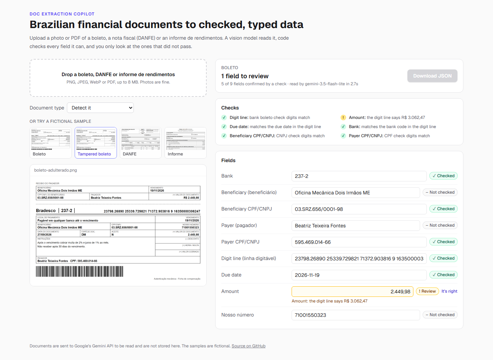
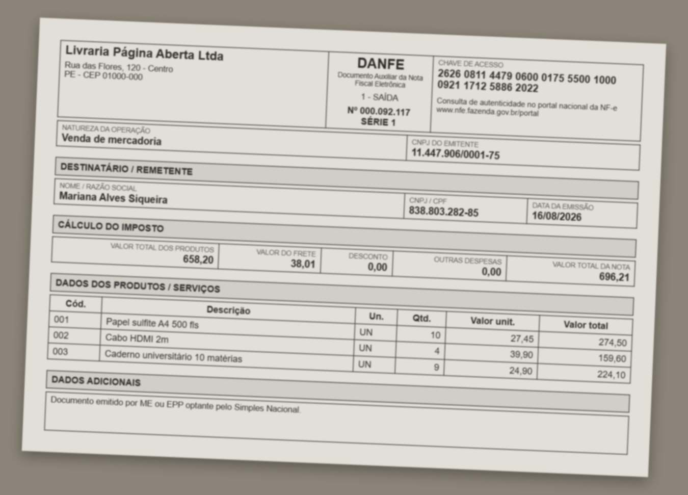

# Doc Extraction Copilot

[](https://github.com/Eric-Souza/doc-extraction-copilot/actions/workflows/ci.yml)

Upload a photo or PDF of a Brazilian financial document (a **boleto**, a **nota fiscal** (DANFE) or a broker's **informe de rendimentos** for the IRPF). A vision model returns every field as typed JSON. Code then checks every field it can: CPF and CNPJ check digits, the boleto's digit line, the NF-e access key, and whether the totals add up. You only review the fields that failed a check or that the model said it was unsure of.

It is part of a small personal-finance set, next to [Renda Fixa Copilot](https://github.com/Eric-Souza/renda-fixa-copilot) and [Currency Copilot](https://github.com/Eric-Souza/currency-copilot).



## What it shows

- **Vision + structured output:** `generateText` with `Output.object` and a Zod schema per document type, sending the image or PDF as a file part. In auto mode a first call classifies the document, then a second one extracts it with that type's schema
- **Checks in code, not in the prompt:** the model is told to copy what is printed, never to fix it. Deciding whether a digit or a total is right is done by deterministic code
- **Review only what needs it:** every field starts as *not checked*, a passing check marks it *checked*, and a failing check or the model's own doubt marks it *review*. The JSON can only be downloaded once nothing is left to review
- **An eval set with known answers:** 36 synthetic documents (clean PNGs, PDFs and phone-photo-style JPEGs), scored per field, with planted inconsistencies to measure whether the checks catch them
- **Guardrails that read twice:** the same checks as [Guardrails AI](https://github.com/guardrails-ai/guardrails) validators in a Python server. A reading that fails one goes back to the model once, with what failed, and the eval measures what that second reading fixes and what it breaks
- **Traces and experiments in Phoenix:** every model call, guard call and validator in one [Phoenix](https://github.com/Arize-ai/phoenix) trace, and each eval run as an experiment on the eval set

## The checks

| Document | What is checked |
|---|---|
| All | CPF and CNPJ check digits (mod 11), including the alphanumeric CNPJ that starts in July 2026; dates are real dates |
| Boleto | The 47-digit bank line (three mod-10 block digits and the mod-11 general digit) or the 48-digit utility line (mod 10 or mod 11, by the value identifier). The amount, due date and bank decoded from the line must match the printed ones. The due date uses the factor that reset to 1000 on 2025-02-22 |
| NF-e (DANFE) | The 44-digit access key's check digit. The key also encodes the state, year and month, issuer CNPJ, model, series and number, and each one must match the printed field. Every line's quantity × unit price must equal its total, the lines must add up to the products total, and products + freight + other − discount must equal the invoice total |
| Informe de rendimentos | Payer CNPJ and taxpayer CPF, the year, and that the exempt-income lines and the exclusive-taxation lines add up to their printed totals |

When a total doesn't add up, the lines that already passed their own quantity × price check aren't flagged, so the review points at the line that is actually wrong.

## Eval

`npm run dataset` renders 36 fictional documents with headless Chromium from a seeded generator: 12 of each type, 35% clean PNG, 30% PDF and 35% phone-photo-style JPEG (rotated, blurred, low contrast, on a table). The last two of each type have a planted inconsistency: a boleto whose printed amount doesn't match its digit line, a DANFE with a line total that is off by R$ 10, and an informe whose exempt-income total is R$ 100 too high. `npm run eval` sends each one to the model, runs the checks, and scores the result against the known answers.

| Model | Field accuracy | Exact match | Flag precision | Flag recall | Silent errors | Planted caught | Median time |
|---|---|---|---|---|---|---|---|
| `gemini-3.5-flash-lite` (default) | 99.9% | 97.2% | 100% | 100% | 0 | 6/6 | 5.4s |
| `gemini-3.1-flash-lite` | 99.5% | 91.7% | 87.0% | 100% | 0 | 6/6 | 6.6s |
| Qwen3.5-2B fine-tuned, on Ollama (`AI_PROVIDER=local`) | 99.7% | 94.4% | 100% | 100% | 0 | 6/6 | 4.2s |
| Qwen3.5-2B base, on Ollama | 7.3% | 0.0% | 100% | 5.8% | 672 | 2/6 | 4.2s |

- **Silent errors** are wrong fields that nobody was asked to look at. That is the number to keep at zero
- A field *should* be flagged if the model read it wrong or if it is part of a planted inconsistency. **Precision** is how many of the flagged fields needed it, and **recall** is how many of the fields that needed it were flagged
- The one misread with the default model was on a rotated photo of a utility boleto: it dropped a zero from a run of zeros (`83660000000-1` became `8366000000-1`). The digit line check caught it
- Gemini 3.1 Flash Lite misread three NF-e access keys and one CNPJ; the check digits flagged all four. Its lower precision is from listing correct beneficiary CNPJs as uncertain, which sends them to review anyway
- The 2B model runs on an 8 GB GPU. Out of the box it calls almost every document a boleto. Fine-tuned in [doc-extraction-finetune](https://github.com/Eric-Souza/doc-extraction-finetune) on 900 documents from this generator (other seeds), it misread one NF-e number and one access key, both flagged by the check digits. It has only seen these templates, so that is the case of training on your own layouts
- The documents are synthetic and cleaner than real photos, so read these numbers as an upper bound. The full reports, with every wrong field, are in [`eval/results/`](eval/results)



## Guardrails: reading twice

The checks also run as [Guardrails AI](https://github.com/guardrails-ai/guardrails) validators, in a small server in [`guard/`](guard). Each check is a custom validator (`br/document-id`, `br/digit-line`, `br/nfe-key`, `br/nfe-totals`, ...) on a Pydantic model per document type. When `GUARD_URL` is set, the API route sends each reading to the server's `/guards/{type}/validate`. If a check fails, the model gets the document again in the same conversation: its first answer, then the failed checks, with an instruction to re-read those fields digit by digit, keep a value the document really prints, and never change one just to make a check pass. The second reading is checked again, and the page says what it changed.

- **One set of checks, two languages:** the browser still runs `review.ts`, which decides what you review. The guard decides whether to re-ask. A parity test (`guard/tests/test_parity.py`) runs the guard on 400 documents (the true values, planted errors included, and every cached model reading) and asserts that it flags exactly the fields `review.ts` flags. CI regenerates those fixtures and fails if they drift
- **Validators never fix a value:** they all use `on_fail="noop"`. A tampered boleto has to stay as printed, so the fix is the model's to make or not
- **Fails open:** if the guard is down, the first reading is returned and the browser's checks still flag it

`npm run eval -- --guard` measures it. The first reading comes from the plain run's cache, so only documents that fail a check cost a second call:

| Model | Re-read | Fields changed | Fixed | Broken | Field accuracy | Silent errors | Planted errors kept |
|---|---|---|---|---|---|---|---|
| `gemini-3.5-flash-lite` | 7 of 36 | 0 | 0 | 0 | 99.9% → 99.9% | 0 → 0 | 6 of 6 |
| Qwen3.5-2B on Ollama (type given) | 28 of 36 | 39 | 38 | 1 | 83.3% → 88.2% | 38 → 31 | 3 of 4 |

- Gemini's seven re-reads were its one misread (a zero dropped from a utility boleto's digit line, on a rotated photo) and the six planted errors. It kept every value, which is right for the planted ones: a second look didn't recover the zero
- The small local model gains most: CPFs and CNPJs read as names, dates left as `12/12/2026`, unit prices that don't multiply out. It fixed 38 fields. 30 had been sent to review, and 8 were silent errors no check had flagged, fixed because the model read the whole document again
- The one field it broke is the risk of a re-ask: on boleto-12, whose printed amount was tampered, it changed the amount to match the digit line, despite being told not to. The check passes after that, so nothing flags it: a new silent error, and planted errors caught drop from 6/6 to 5/6. Of the 4 planted errors it had read right, the other 3 stayed as printed. A re-ask is worth it on a weak reader, but a strong one gains nothing, and on either the planted cases show it can talk a model into hiding the error it was meant to surface
- Guardrails 0.11 drops null fields from its output, and then counts a failure on the whole document as fixed, so `validationPassed` can be `true` with a failed check. The app reads the failed validator summaries instead

## Tracing with Phoenix

With `PHOENIX_COLLECTOR_ENDPOINT` set (`http://localhost:6006` for a local `phoenix serve`), the app (`src/instrumentation.ts`) and the eval send OpenTelemetry spans to [Phoenix](https://github.com/Arize-ai/phoenix): the AI SDK's model calls through [OpenInference](https://github.com/Arize-ai/openinference)'s span processor, and a `guard` span per validate call. The guard server traces itself (Guardrails 0.11 emits a GUARDRAIL span per validator) and reads the `traceparent` header, so one document is one trace: classify, read, guard and its validators, read again, guard again.

`npx tsx scripts/phoenix-experiments.ts <run> <run> ...` uploads the eval set as a Phoenix dataset and logs cached runs from `eval/results/` as experiments, scored with the same code as the eval: field accuracy, silent errors, exact match, planted error caught, and whether the guard had the document read again. No model is called, so comparing the plain and guarded runs document by document costs nothing.

## Stack

| Area | Choice |
|------|--------|
| Framework | Next.js 16 (App Router), React 19, TypeScript |
| AI | Vercel AI SDK 6 (`ai`, `@ai-sdk/google`) |
| Model | Gemini 3.5 Flash Lite (free tier, 500 requests a day) |
| Validation | Zod; Guardrails AI 0.11 server (Python, FastAPI) |
| Tracing | OpenTelemetry, OpenInference, Arize Phoenix |
| UI | Tailwind CSS |
| Tests | Vitest, Playwright |

## Project structure

```
doc-extraction-copilot/
  src/
    app/api/extract/route.ts  # upload → classify → extract
    components/extractor.tsx  # upload, preview, review and correct fields
    lib/
      br/                     # CPF/CNPJ, boleto digit lines, NF-e access keys
      schemas.ts              # a Zod schema per document type
      extract.ts              # the vision calls
      review.ts               # the checks, and which fields need review
      synthetic.ts            # seeded fictional documents for the eval
      templates.ts            # HTML for boletos, DANFEs and informes
      score.ts                # per-field scoring and flag precision/recall
      mock-model.ts           # scripted model for the end-to-end tests
      guard.ts                # calls the guard server, and the re-ask message
      tracing.ts              # OpenTelemetry to Phoenix
  guard/                      # Guardrails AI server: the checks as validators, parity test
  scripts/                    # make-dataset.ts, eval.ts, guard-fixtures.ts, phoenix-experiments.ts
  eval/data/                  # the 36 documents and their labels
  eval/results/               # reports per model
  tests/                      # Vitest
  e2e/                        # Playwright
```

## Getting started

```bash
cp .env.example .env.local   # set GOOGLE_GENERATIVE_AI_API_KEY
npm install
npm run dev                  # http://localhost:3000
npm test                     # unit tests: no API key needed
npm run test:e2e             # Playwright against the production build and a scripted model
npm run dataset              # regenerate the eval documents
node --env-file=.env.local node_modules/tsx/dist/cli.mjs scripts/eval.ts   # run the eval (--known-type skips classification, --guard re-asks)
```

The guard, with [uv](https://docs.astral.sh/uv/):

```bash
cd guard
uv run pytest                                              # parity with review.ts
PYTHONPATH=. uv run uvicorn serve:app --port 8100           # then GUARD_URL=http://localhost:8100
```

It runs under uvicorn rather than `guardrails start`, which pings Guardrails' servers before loading the config; `doc_guard/__init__.py` also turns their usage metrics off.

| Variable | Default | What it does |
|---|---|---|
| `GOOGLE_GENERATIVE_AI_API_KEY` | none | From [AI Studio](https://aistudio.google.com/apikey) |
| `AI_MODEL` | `gemini-3.5-flash-lite` | Any Gemini model with vision |
| `AI_PROVIDER` | `google` | `mock` runs against a scripted model, with no key |
| `GUARD_URL` | none | The guard server. When set, a reading that fails a check is read again |
| `PHOENIX_COLLECTOR_ENDPOINT` | none | A Phoenix to send traces to |

The eval caches each answer in `eval/results/<model>/`, so a run that hits the free tier's per-minute limit can be resumed without spending the quota again.

## Privacy

Documents are sent to Google's Gemini API to be read and are not stored by the app. Gemini's free tier may use what is sent to improve Google's products, so don't upload real documents to a deployment on a free key. Every sample and eval document here is fictional.
